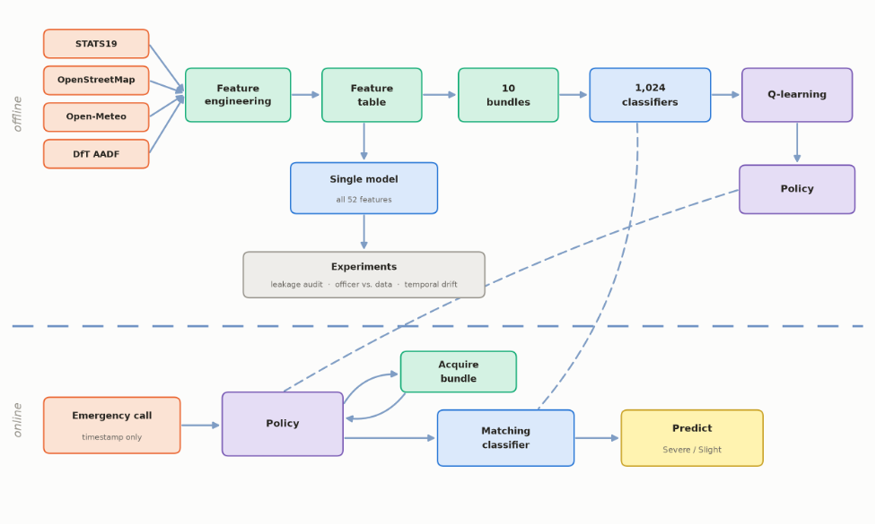

# Predicting Road Accident Severity in the UK
### A Multi-Source Machine Learning Approach

> **Course:** Project in Artificial Intelligence (02360502) — Spring 2026

> **Students:** Ibraheem Akaree — ibraheema@campus.technion.ac.il · Sewar Abahry — sewar.abahry@campus.technion.ac.il

> **Advisor:** Yotam Gavish

---

## Overview

When an accident is reported to emergency services, a dispatcher has seconds to decide what level of response to send. This project asks:

> *Given only what is known at the moment of a 999 call, can we predict how severe the accident is — and is it worth spending time finding out more before deciding?*

Two halves answer that. A bank of classifiers predicts severity from whatever information is currently held. On top of them sits a reinforcement learning agent that decides, call by call, **which further information is worth acquiring** before committing to a prediction — because every question to a caller and every lookup costs time a dispatcher does not have.

---

## How it works



**Offline.** Four public sources are joined into one feature table per collision. The features are grouped into **10 acquisition bundles**, each standing for one real-world act — a question to the caller, a lookup against the coordinate, or an API call. Every combination of those bundles gets its own classifier, giving **1,024 pre-trained models** that are frozen before any agent training starts. Those models *are* the environment the agent acts in, and a Q-learning agent is trained over them to produce an acquisition policy.

**Online.** A call arrives carrying only a timestamp. Each time a bundle is acquired, the classifier matching exactly the bundles now held re-predicts — so a prediction always exists, and its confidence is part of what the policy reads. The policy looks at what is held and how confident that prediction is, then either asks for one more bundle or stops. Stopping commits to the prediction already in hand rather than computing a new one.


---

## Data sources

| Source | Role | Cost |
|---|---|---|
| [STATS19 (DfT)](https://github.com/ropensci/stats19) | Primary dataset and labels | Free |
| [DfT AADF Traffic](https://roadtraffic.dft.gov.uk/downloads) | Traffic volume at the nearest count point | Free |
| [OpenStreetMap](https://overpass-api.de) | Road infrastructure — signals, lanes, calming, cameras | Free |
| [Open-Meteo Historical](https://open-meteo.com/en/docs/historical-weather-api) | Weather at the exact location and hour | Paid |

STATS19 links three tables by collision reference: **collisions** (location, time, road, conditions, severity), **casualties** (age, sex, class, injury), and **vehicles** (type, manoeuvre, driver). Only collision-level and aggregated casualty/vehicle facts a dispatcher could plausibly learn during a call are used as features.

---

## Repository structure

```
CODE/
├── run_pipeline.R          orchestrates the R data pipeline only — the two
│                           folders below it. Training is run separately.
│
├── downloading/            STATS19 download and severity-aware sampling
├── processing/             the R feature pipeline
│   ├── stats19/              collision, vehicle and casualty feature builders
│   └──  aadf/  osm/  meteo/   one folder per external source
│   
│
├── training/
│   ├── train/              classifiers — including the 1,024-model sweep
│   ├── tune/               hyperparameter search for the classifier
│   └── agent/              the RL acquisition agent  (own README)
│
├── simulator/              browser tool to watch the agent on one call (own README)
└── experiments/            one-off analyses: leakage audit, officer vs. data,
                            temporal drift, model comparison

data/
├── raw/                    one folder per source, as downloaded
├── features/               sequential pipeline stages, named by sources folded in
└── splits/                 train/valid/test, and their normalized form

docs/
├── data_pipeline.md        the detailed pipeline reference
└── figures/                every figure and results table

models/                     trained models (gitignored — regenerate from the sweep)
```

**Everything runs from the repository root.** Paths inside the scripts resolve against the working directory, not against the script's own location.

---

## Running it

The data pipeline and the models are two separate stages. The first prepares
the data and stops; nothing downstream runs automatically.

```bash
# 1. Data engineering only: download, join, engineer features, split, normalise
Rscript CODE/run_pipeline.R

# 2. Python environment
source .venv/bin/activate
pip install -r requirements.txt

# 3. Train the 1,024 acquisition-subset classifiers (resumable)
python CODE/training/train/bundle_sweep.py

# 4. Train the acquisition agent over them, once per cost setting.
#    There is no single agent: lambda prices a second of acquisition in
#    accuracy, and each value gives a different, equally valid policy. The
#    reported results sweep it, 3 seeds per value.
python CODE/training/agent/analysis/lambda_curve.py                      # lambda 0 .. 0.10
python CODE/training/agent/analysis/lambda_curve.py \
       --lambdas 0.2 0.3 0.5 1 2 3 5 10 \
       --out-dir docs/figures/lambda_curve_log                           # the sparse tail
python CODE/training/agent/analysis/plot_lambda_curve.py                 # combine + figures

#    To train one agent at one lambda instead:
#      --warm-start seeds the Q-table from the sweep's measured subset scores,
#      rather than from zeros, which does not learn on this problem.
python CODE/training/agent/train_rl_agent.py --warm-start --cost-scale 0.01

# 5. Watch it work on a single call, in a browser
python CODE/simulator/app.py
```

Most R stages accept `--debug` for a fast smoke test on a few rows.

---

## Where to read more

| | |
|---|---|
| The data pipeline, stage by stage | `docs/data_pipeline.md` |
| The acquisition agent | `CODE/training/agent/README.md` |
| The simulator | `CODE/simulator/README.md` |
| Results, figures and tables | `docs/figures/` |
